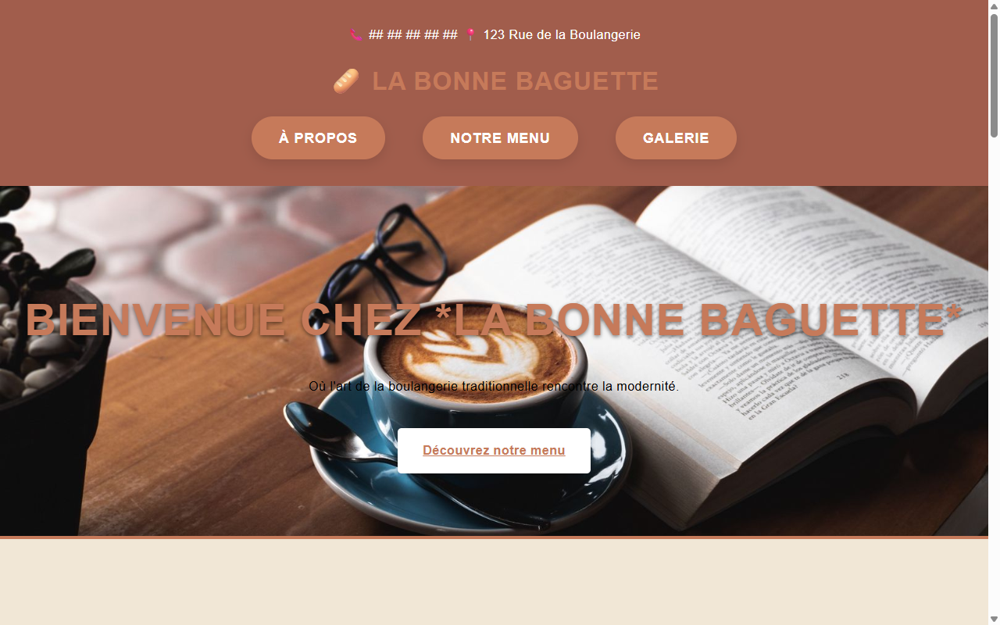

# La Bonne Baguette — Site Vitrine Boulangerie

  
  
  
  

  

 

Site vitrine interactif et chaleureux pour une boulangerie artisanale traditionnelle, mettant en valeur les spécialités de pains, viennoiseries, pâtisseries et les horaires d'ouverture.

---

## Démo en Ligne

Le site est hébergé sur GitHub Pages :  
**[https://nedjaryanis.github.io/index-boulange/](https://nedjaryanis.github.io/index-boulange/)**

---

## Fonctionnalités Principales

- **Présentation de la Boulangerie** : Histoire, valeurs de fabrication artisanale et savoir-faire traditionnel.
- **Catalogue des Spécialités** : Grille visuelle des créations artisanales (Pains au levain, Baguettes de tradition, Pâtisseries du jour).
- **Informations Pratiques** : Horaires d'ouverture actualisés, localisation et plan d'accès.
- **Formulaire de Contact** : Prise de contact directe et commandes spéciales pour événements.

---

## Technologies Utilisées

- **HTML5 Sémantique** : Balisage soigné pour un bon référencement local.
- **CSS3 Moderne** : Design chaleureux, intégration de polices élégantes et adaptation mobile complète.
- **JavaScript Vanilla** : Animation au défilement et interactions interactives légères.

---

## Auteur

Projet conçu et développé par **[Yanis Nedjar](https://github.com/NedjarYanis)**.
